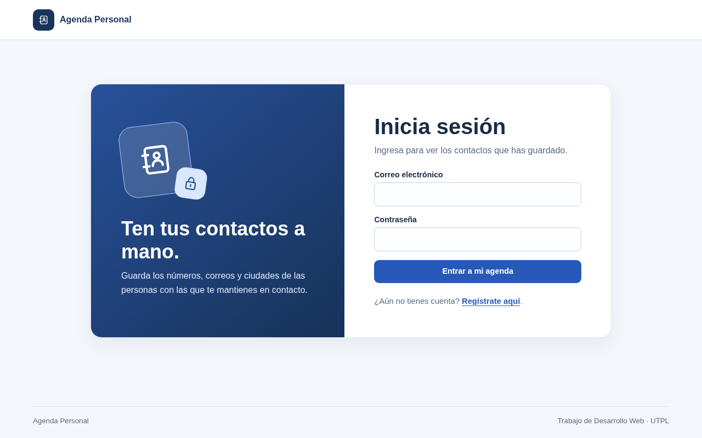
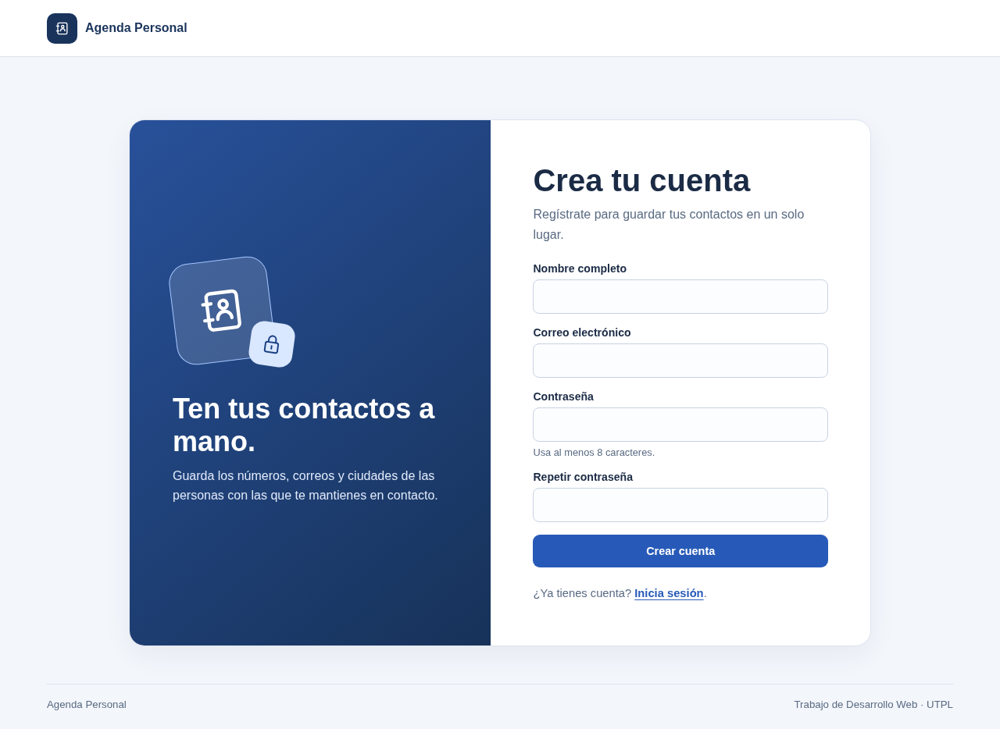

**Universidad Técnica Particular de Loja (UTPL) — Desarrollo Web**

Este proyecto es una continuación de la agenda de contactos que desarrollé en la práctica anterior. La primera versión permitía crear una cuenta y administrar contactos. Para esta actividad añadí opciones de búsqueda, ordenamiento, categorías y favoritos, con la idea de que la agenda sea más fácil de usar cuando se tienen varios contactos guardados.

También publiqué la aplicación en Hostinger para que se pueda abrir desde Internet.

## Enlaces del proyecto

- **Aplicación web:** https://delicate-mistyrose-magpie-55.hostingersite.com/
- **Panel de contactos:** https://delicate-mistyrose-magpie-55.hostingersite.com/dashboard.php
- **Repositorio GitHub:** https://github.com/KEN101010/agenda-personal-utpl-
- **Script SQL:** [`database.sql`](database.sql)

> Para entrar al panel se necesita iniciar sesión. Si es la primera vez que se utiliza la aplicación, se puede crear una cuenta desde la pantalla de registro. Cada usuario administra sus propios contactos.

## Funciones principales

La agenda permite registrarse, iniciar y cerrar sesión, agregar contactos con nombre, teléfono, correo y ciudad, editar sus datos y eliminarlos con una pantalla de confirmación.

En esta segunda versión incorporé las **cuatro mejoras** propuestas en la actividad:

| Mejora | ¿Cómo funciona? |
| --- | --- |
| **Búsqueda** | Permite encontrar contactos por nombre, correo electrónico o ciudad. También se puede buscar en todos los campos. |
| **Ordenamiento** | Organiza los resultados por nombre o ciudad, de A a Z o de Z a A, y por fecha de creación, de más reciente a más antiguo o al revés. |
| **Categorías** | Cada contacto pertenece a una categoría: **Familia, Amigos, Trabajo, Universidad u Otro**. También se puede filtrar el directorio por categoría. |
| **Favoritos** | Se puede marcar o desmarcar un contacto como favorito y activar el filtro **Solo favoritos**. |

Los filtros se pueden combinar. Por ejemplo, puedo buscar un nombre, seleccionar la categoría Universidad y ordenar los resultados sin tener que revisar toda la lista.

## Diferencias con la primera práctica

| Primera versión | Versión actual |
| --- | --- |
| Listado básico de contactos. | Listado con buscador y filtros. |
| Orden fijo por nombre. | Ordenamiento configurable por nombre, ciudad y fecha. |
| Sin clasificación de contactos. | Cinco categorías disponibles. |
| Sin contactos destacados. | Opción de favoritos y filtro específico. |
| Tablas de usuarios y contactos. | Nueva tabla `categorias` y campos adicionales en `contactos`. |
| Uso local con XAMPP. | Instalación local y despliegue en Hostinger. |

## Tecnologías utilizadas

- **PHP:** registro, inicio de sesión, validaciones y operaciones con contactos.
- **MySQL / MariaDB:** almacenamiento de usuarios, contactos y categorías.
- **PDO:** conexión y consultas preparadas a la base de datos.
- **HTML5 y CSS3:** estructura y diseño adaptable a celular y computadora.
- **Apache:** servidor web para la ejecución de PHP.
- **GitHub:** repositorio del código y la documentación.
- **Hostinger:** alojamiento de la versión publicada.

No se necesitan dependencias de Composer ni paquetes de Node.js para ejecutar este proyecto.

## Capturas de pantalla

**Inicio de sesión:** desde aquí se accede a la agenda con una cuenta existente.



**Registro:** formulario para crear una cuenta nueva.



El panel privado permite buscar y ordenar contactos, filtrarlos por categoría y marcar favoritos. Para verlo en funcionamiento, se puede acceder a la [aplicación publicada](https://delicate-mistyrose-magpie-55.hostingersite.com/) y registrar una cuenta de prueba.

## Base de datos

El archivo [`database.sql`](database.sql) prepara una instalación nueva con estas tablas:

- `usuarios`: información de las cuentas y contraseñas almacenadas como hashes.
- `categorias`: las cinco categorías que se pueden asignar a los contactos.
- `contactos`: datos de cada contacto, propietario, categoría, indicador de favorito y fecha de creación.

Si ya existe una base de datos de la primera práctica y se quieren conservar sus registros, primero se debe hacer una copia de seguridad y utilizar [`migracion_desde_v1.sql`](migracion_desde_v1.sql) **en lugar de** instalar el esquema nuevo encima. La migración se ejecuta una sola vez.

## Instalación local con XAMPP

1. Descargar el repositorio desde **Code → Download ZIP** o clonarlo con Git.
2. Copiar la carpeta del proyecto a `C:\xampp\htdocs\agenda-personal\`.
3. Abrir XAMPP e iniciar los servicios **Apache** y **MySQL**.
4. Entrar a `http://localhost/phpmyadmin`, crear una base de datos llamada `agenda_personal` e importar el archivo `database.sql` dentro de ella.
5. Revisar `config/database.php`. La configuración inicial está pensada para XAMPP: servidor `127.0.0.1`, puerto `3306`, usuario `root` y contraseña vacía. Si la instalación utiliza otros datos, copiar `config/database.local.example.php` como `config/database.local.php` y ajustar esa copia.
6. Abrir `http://localhost/agenda-personal/`, crear una cuenta y comenzar a registrar contactos.

## Publicación en Hostinger

La aplicación está publicada en el enlace indicado al principio del README. Para instalarla en otro alojamiento con PHP y MySQL, estos son los pasos principales:

1. Crear una base de datos MySQL desde el panel del hosting.
2. Entrar a phpMyAdmin, seleccionar esa base e importar `database.sql`.
3. Subir los archivos PHP y las carpetas `assets`, `config` e `includes` a `public_html`. El archivo `index.php` debe quedar directamente dentro de esa carpeta.
4. En `config`, crear `database.local.php` a partir de `database.local.example.php` y colocar el servidor, nombre de base de datos, usuario y contraseña proporcionados por el hosting.
5. Abrir la dirección del sitio, registrar una cuenta y probar las funciones del directorio.

En Hostinger, el nombre de la base y el usuario MySQL pueden llevar un prefijo. Es importante usar los nombres completos que aparecen en su panel.

**Seguridad:** `config/database.local.php` contiene credenciales privadas y **no debe subirse a GitHub**. Tampoco deben publicarse archivos de diagnóstico ni contraseñas reales. Si se cambian las credenciales de MySQL, también se deben actualizar en la configuración privada del sitio.

La explicación detallada del despliegue está en [`GUIA_HOSTINGER.md`](GUIA_HOSTINGER.md).

## Archivos principales

```text
assets/css/app.css                  Estilos de la interfaz
config/database.php                Configuración base de MySQL
config/database.local.example.php  Ejemplo de configuración privada
includes/                          Conexión, sesiones, formularios y vistas
index.php                          Entrada de la aplicación
registro.php                       Creación de cuentas
login.php                          Inicio de sesión
dashboard.php                      Directorio, búsqueda y filtros
crear.php                          Registro de contactos
editar.php                         Edición de contactos
favorito.php                       Marcar o quitar favoritos
confirmar.php                      Confirmación de eliminación
eliminar.php                       Eliminación de contactos
logout.php                         Cierre de sesión
database.sql                       Esquema de base de datos
migracion_desde_v1.sql             Migración desde la primera versión
docs/capturas/                     Capturas de la aplicación
GUIA_HOSTINGER.md                  Guía de publicación
README.md                          Documentación del proyecto
```

## Comprobaciones recomendadas

Para revisar el funcionamiento de la aplicación se puede hacer una prueba rápida:

1. Registrar una cuenta, cerrar sesión e iniciar sesión nuevamente.
2. Crear contactos de distintas categorías y editar los datos de uno.
3. Buscar por nombre, correo y ciudad.
4. Probar los seis tipos de ordenamiento.
5. Marcar un contacto como favorito y activar **Solo favoritos**.
6. Combinar búsqueda, categoría y favoritos; luego limpiar los filtros.
7. Eliminar un contacto y comprobar que ya no aparece.
8. Verificar que una segunda cuenta no puede ver los contactos de la primera.

El proyecto utiliza consultas preparadas, validación de formularios, contraseñas con `password_hash()` y controles de sesión para separar los contactos de cada usuario.

---

**Entrega académica:** actividad B1 de Desarrollo Web — UTPL. Los entregables son la URL pública de la aplicación, el repositorio actualizado y el script SQL.
